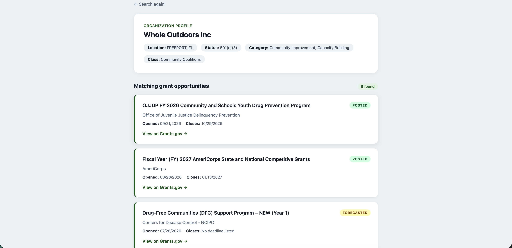

# Grant Matcher

A Node.js web app that helps small nonprofits find federal grants that fit their mission. Enter an organization, and Grant Matcher pulls its profile from a charity database, works out what it actually does, and searches Grants.gov for open opportunities that match.

> **Status: paused.** The core matching flow works end to end. I stopped active development after researching the space: established tools like Instrumentl, Candid, and OpenGrants already serve this need well, and the free API tiers made the app hard to run at no cost. The project taught me a lot about combining APIs and designing search logic, so I've left it up as a record of that work.

## The problem

Small nonprofits often don't have a grant writer, and Grants.gov is hard to search if you don't already know the right keywords. A keyword search for "outdoors" misses grants filed under "recreation," "conservation," or "youth development." Grant Matcher builds the search from the organization's own profile instead of relying on the user to guess the right terms.

## How it works

1. **Read the organization first.** The app looks up the nonprofit through the OrgHunter Charity API and collects its mission statement and NTEE code, the IRS category system for nonprofits.
2. **Build keywords from the best source available.** Keyword quality is tiered:
   - the user's own description of their work, if they provide one
   - otherwise the organization's mission statement
   - otherwise keywords built from its NTEE classification and activity fields
3. **Match second.** Those keywords drive a Grants.gov search limited to open or forecasted grants that 501(c)(3) nonprofits are eligible for.
4. **Clean up the results.** Grants that opened more than a year ago are filtered out after the fetch, and the rest are sorted newest first, so users only see opportunities still worth reading.



## Design decisions

- **Read first, match second.** Searching only after understanding the organization produces far more relevant results than a plain keyword search.
- **Newest grants first.** Grants.gov sorts search results by open date by default (`openDate|desc`). I tested `relevance|desc` in Postman, but it returned zero results for searches that otherwise matched hundreds of grants, so the app uses date order and re-sorts after its date filter to keep it consistent.
- **Post-fetch date filter.** Grants.gov returns many stale listings, so the app filters them out after each search rather than relying on the API's filters.
- **Real test case.** I tested against [Whole Outdoors](https://wholeoutdoors.org), a nonprofit with a varied, multi-category mission, to stress the keyword logic.

## Tech stack

- **Backend:** Node.js, Express
- **Views:** EJS templates
- **HTTP:** Axios with async/await
- **APIs:** [OrgHunter Charity API](https://charityapi.orghunter.com/), [Grants.gov Search API](https://www.grants.gov/api)
- **Testing APIs:** Postman

## Running locally

You'll need Node.js 18+ and an OrgHunter API key.

```bash
git clone https://github.com/Dav-Zuko/grant-matcher.git
cd grant-matcher
npm install
```

Create a `.env` file in the project root:

```
ORGHUNTER_API_KEY=your_key_here
```

Then start the server:

```bash
node index.js
```

Open http://localhost:3000 in your browser.

## What I'd do next

If I picked it back up, I'd:
- cache API responses to stay within free-tier limits
- add saved searches with a small database (PostgreSQL)
- rebuild the frontend in React for live filtering
- score each grant against the organization's profile instead of relying only on keyword matching

## What I learned

- Designing a data flow across two APIs that weren't built to work together
- Writing fallback logic when the best data source is missing
- Testing assumptions against the real API: I thought removing `sortBy` restored relevance ranking, but the `searchParams` the API echoed back showed it defaults to newest first
- Doing competitive research before investing more time, and knowing when to stop
